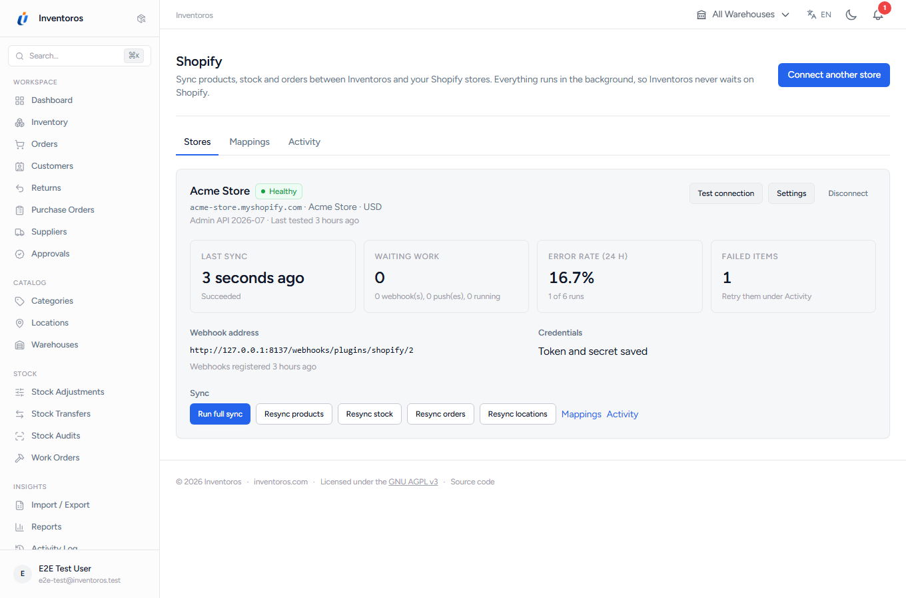
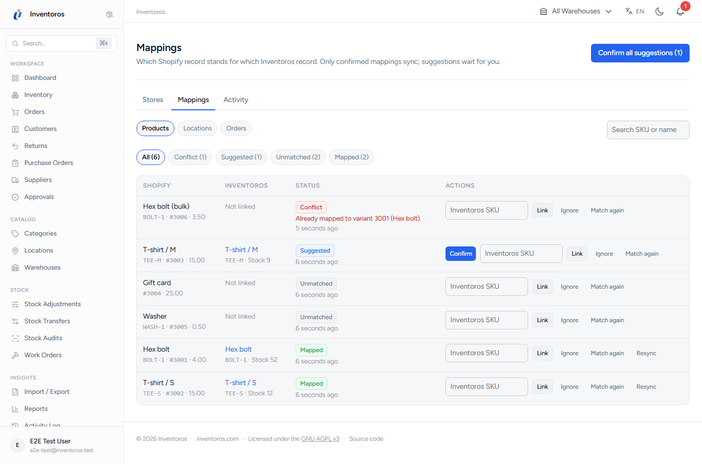
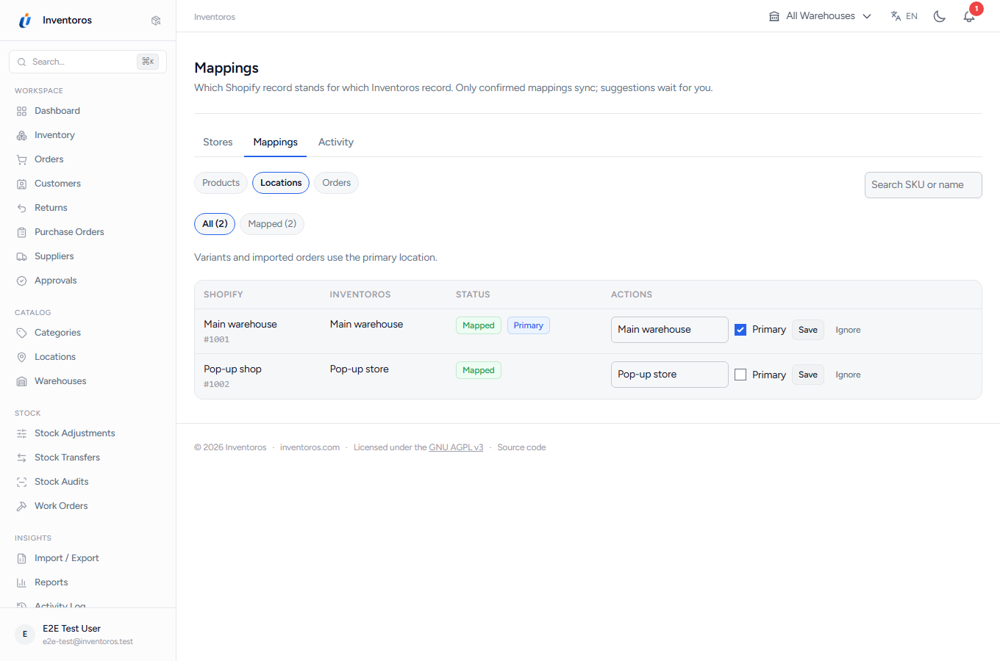
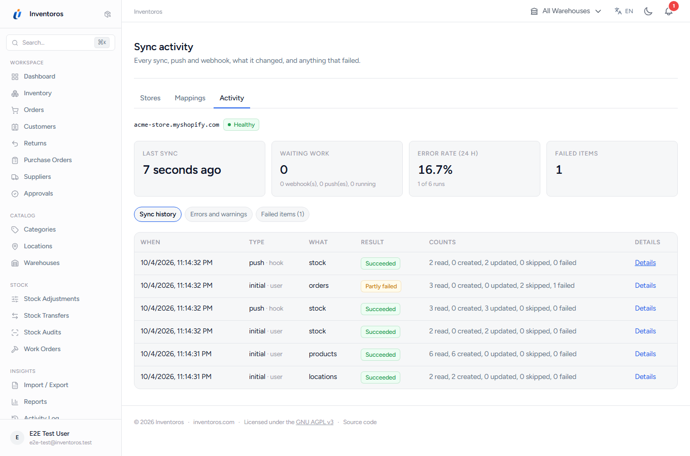
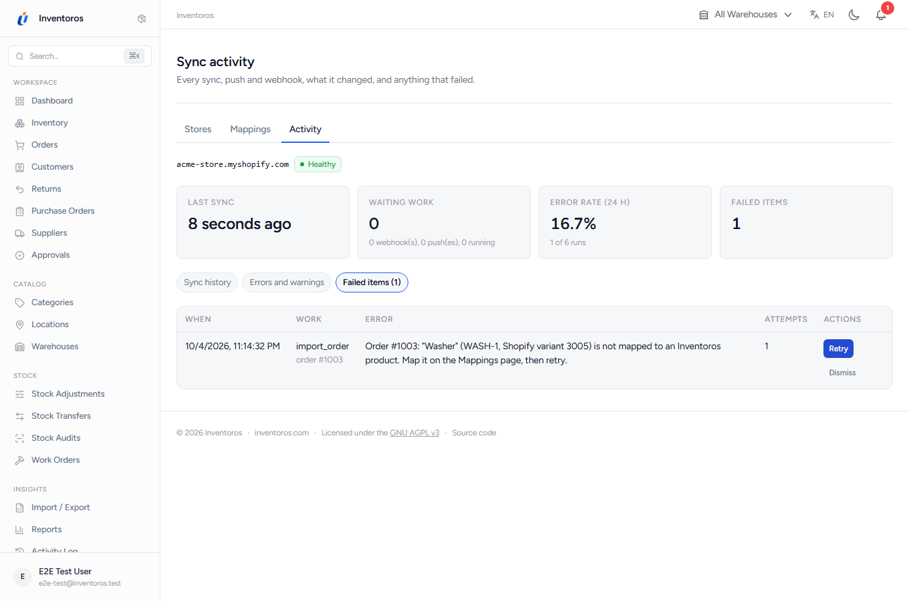
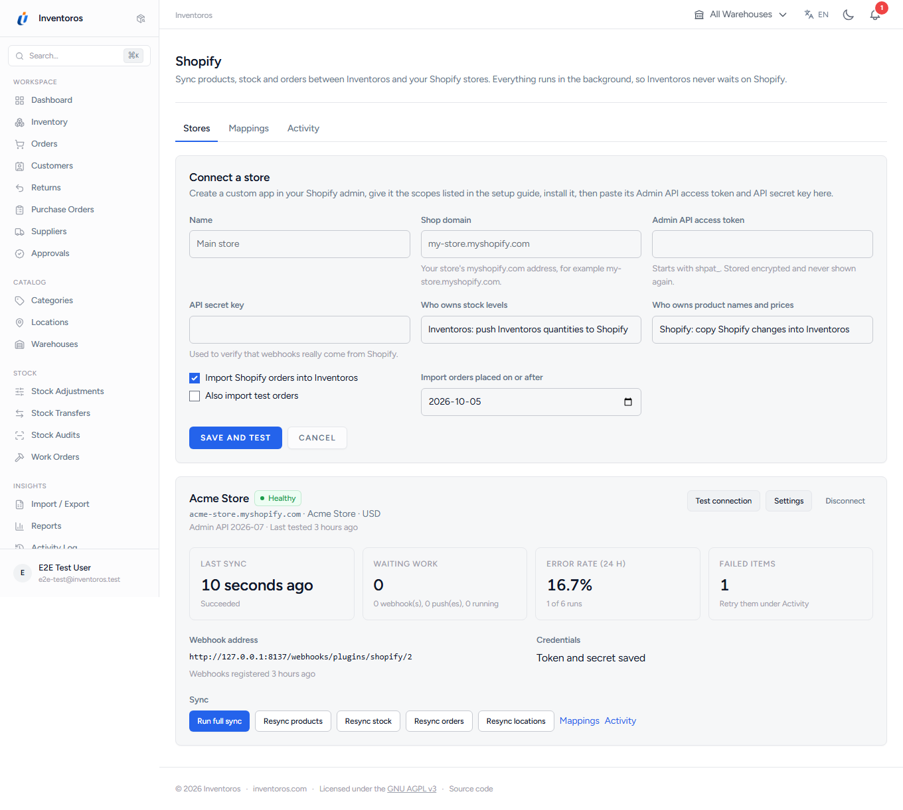
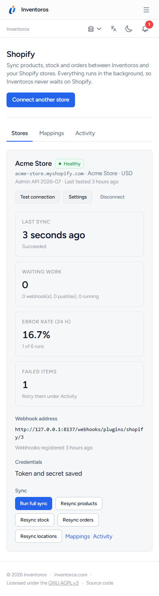

# Shopify for Inventoros

**Two-way product, stock and order sync for Shopify.** An Inventoros Official plugin (free, AGPL-3.0-or-later).

Connect your Inventoros inventory workflows with Shopify. Synchronize products, inventory levels and orders in both directions through asynchronous processing.

Use mappings to connect records between systems. Webhooks and retries support the sync process, while sync history and health information help you review its status.



## Contents

- [Features](#features)
- [Screenshots](#screenshots)
- [Install](#install)
- [Set up a store](#set-up-a-store)
- [Configuration](#configuration)
- [Permissions](#permissions)
- [Compatibility](#compatibility)
- [Develop and test](#develop-and-test)
- [FAQ](#faq)
- [License](#license)

## Features

- **Orders into Inventoros, exactly once**: through core's `OrderService` (ledger rows, bins, serials), with `external_reference` set, safe against duplicate, replayed and out-of-order webhooks. Shopify cancellations cancel and restock through core.
- **Stock both ways, one owner**: Inventoros quantities pushed per mapped location, coalesced per item and queued; or Shopify levels applied as audited core adjustments.
- **Products both ways, one owner**: Shopify titles and prices copied into Inventoros, or Inventoros edits pushed to Shopify.
- **Mapping review**: SKU matches are suggestions until you confirm them; conflicts and unmatched variants are listed, never guessed. Shopify locations map to warehouses.
- **Webhooks** verified by HMAC, stored in an idempotent inbox and processed in the background, plus a 15-minute incremental sync as a safety net.
- **Retries and rate limits**: Retry-After, Shopify's GraphQL cost limit, backoff, a circuit breaker, and failed work you can retry from the UI.
- **Health and history**: last sync, waiting work, error rate, every run with its per-record log, errors and failed items.
- **Never blocks Inventoros**: no request waits on Shopify.
- `shopify.order_imported` and `shopify.sync_failed` webhook events, and a read-only `shopify_sync_status` MCP tool.
- Built on the reusable [integration kit](src/Kit/README.md) shared by the Inventoros integration plugins.

## Screenshots

| | |
|-|-|
|  |  |
|  |  |
|  |  |

## Install

From a release: download `shopify-X.Y.Z.zip` from the [releases](../../releases), upload it in **Plugins**, then activate it. Or install it from **Plugins > Marketplace** once it is listed.

From source:

```bash
cd ui && npm ci && npm run build && cd ..
cp -r . /path/to/inventoros/plugins/shopify     # the folder name is the slug
php artisan plugin:activate shopify              # from the Inventoros root
```

Activation creates the plugin's `plg_shopify_*` tables. Deactivation keeps them. Deleting the plugin drops them and removes its permissions from roles; orders it imported and stock changes it made are core records and stay.

The plugin needs the Inventoros **queue worker** and **scheduler** running (`shopify:sync` every 15 minutes, `shopify:prune` daily). On cPanel the scheduler drains the queue too.

## Set up a store

In short: create a custom app in the Shopify admin with the scopes `read_products`, `write_products`, `read_inventory`, `write_inventory`, `read_locations` and `read_orders`, install it, then paste its Admin API access token and API secret key under **Shopify > Connect a store**. Map locations to warehouses, run a full sync and confirm the SKU suggestions.

The step-by-step guide, with what each status means: **[docs/setup.md](docs/setup.md)**. How orders, stock, products, webhooks and retries behave: **[docs/sync.md](docs/sync.md)**.

## Configuration

Per connection, on the store card's **Settings**:

| Setting | Default | Effect |
|---------|---------|--------|
| Who owns stock levels | Inventoros | Inventoros pushes quantities; or Shopify's levels are applied to Inventoros |
| Who owns product names and prices | Shopify | Shopify edits copied in; or Inventoros edits pushed out |
| Import Shopify orders | On | Orders flow into Inventoros |
| Also import test orders | Off | |
| Import orders placed on or after | The day you connect | Older orders are skipped |

## Permissions

| Permission | Allows |
|------------|--------|
| `shopify.view` (View Shopify sync) | The Shopify pages and the `shopify_sync_status` MCP tool |
| `shopify.manage` (Manage Shopify sync) | Connecting stores, settings, mappings, syncs, retrying and dismissing failed work |

Admins hold both. On Inventoros versions without plugin permissions they fall back to **View Settings** and **Edit Settings**. Every action is checked on the server and limited to the user's organization.

## Compatibility

- Inventoros 2.0.0 or newer with the plugin SDK of Inventoros#250 and #251 (plugin permissions, shared UI components and translations, `stock_changed` and the other domain hooks, `register_webhook_event`, `register_mcp_tool`). Plugin permissions, webhook events and the MCP tool are feature-detected and skipped on cores without them; the `stock_changed` hook is required for stock pushes.
- On cores with organization memberships (Inventoros#257) members from other organizations are included as the user a connection acts as; older cores use the home organization only.
- PHP 8.4+. Shopify Admin GraphQL API **2026-07** (pinned in `ShopifyClient::API_VERSION`).
- Tested against Inventoros `main` on SQLite, PostgreSQL and MySQL.
- Routes follow the plugin route namespace: names `plg.shopify.*`, pages and actions under `/p/shopify/` (the overview moved from `/shopify` to `/p/shopify` in 1.0.1; update bookmarks). The webhook address, `/webhooks/plugins/shopify/{connection}`, is unchanged, so subscriptions registered by 1.0.0 keep delivering and nothing needs re-registering.
- The sidebar item is translated on cores that translate plugin menu items (`label_key`).
- Known limitations and SDK gaps:
  - Orders commit Inventoros stock when imported. Cores with reservations exclude local holds from pushed availability; older releases do not provide reservation support.
  - On cores with variant location stock, each variant syncs its own bins per mapped warehouse. Older cores retain primary-location variant sync. Local and global stock holds reduce pushed availability; warehouse quantities share a single SKU availability budget, allocated primary location first.
  - On cores before Inventoros#254, `OrderService::cancel()` takes its actor from the signed-in user, so the plugin signs in the connection's user for that one call when it cancels in a background job. Newer cores take the actor as a parameter and nobody is signed in.
  - Optional shipment fulfilment and tracking push is available on cores with shipment notification ownership. Refunds and order edits after import are not applied.
  - No public OAuth app yet (custom app tokens only); see [docs/setup.md](docs/setup.md#7-future-a-public-app-with-oauth).

## Develop and test

The tests run inside a real Inventoros against a fake store built from recorded Shopify responses (`tests/Fixtures`); no test calls Shopify.

```bash
git clone https://github.com/Inventoros/Inventoros.git && cd Inventoros
composer install && cp .env.example .env && php artisan key:generate
git clone git@github.com:Inventoros/plugin-shopify.git plugins/shopify
(cd plugins/shopify/ui && npm ci && npm run build)
vendor/bin/phpunit -c plugins/shopify/phpunit.xml          # SQLite
vendor/bin/phpunit -c plugins/shopify/phpunit.pgsql.xml    # PostgreSQL (DB_* from the environment)
vendor/bin/phpunit -c plugins/shopify/phpunit.mysql.xml    # MySQL
```

README screenshots: `SCREENSHOTS=1 npx playwright test -c plugins/shopify/e2e/playwright.config.ts` against a served, seeded core (see the config file).

## FAQ

**Does Inventoros slow down when Shopify is slow or down?** No. Requests only queue work; Shopify outages show up as retries and failed items, and the connection pauses itself after repeated failures.

**What if the same order arrives twice, or the update before the create?** It is imported once. Older updates are ignored.

**Can two stores sync into one organization?** Yes, one connection per store; each has its own mappings. Two organizations can also connect two different stores; they never see each other's data.

**What happens to my data if I remove the plugin?** Its own tables are dropped. Imported orders, stock adjustments and products stay in Inventoros.

**Where does the integration kit live?** In `src/Kit`, with a README on copying it into another integration plugin.

## License

AGPL-3.0-or-later. See [LICENSE](LICENSE).

## Shipment fulfilment and tracking

After upgrading the core with shipment notification ownership, grant the custom app `read_merchant_managed_fulfillment_orders` and `write_merchant_managed_fulfillment_orders`, then enable **Push shipments and tracking to Shopify** in the connection settings. This is off by default. Map each ship-from warehouse to exactly one Shopify location.

Newly imported order lines retain their exact Shopify line ids. When an Inventoros shipment is marked shipped, queued work fulfils only those shipped quantities, includes tracking, and lets Shopify send the shipping email if the customer notification option is enabled. The core email is suppressed for those shipments. Older imported orders without exact line mappings must be fulfilled in Shopify. Shipping never deducts Inventoros stock a second time.

If routing differs, the plugin activates previously unstocked inventory items at the destination, without resetting existing quantities, before moving only the shipment’s fulfilment-order lines. Moves re-read Shopify because order and line ids may change. Fulfilment holds and unsupported service requests stop the push for review. Read pages and definite throttles use the existing delayed retries.

Shopify’s [fulfillmentCreate](https://shopify.dev/docs/api/admin-graphql/2026-07/mutations/fulfillmentCreate) does not document a creation idempotency key. The plugin commits a send claim before creation, persists the returned id, and refuses to blindly replay an uncertain response or a killed worker’s claim. Check the failed operation in Sync activity and verify or finish that shipment in Shopify; repeated retries cannot create another fulfilment. This conservative stop also applies to rejected creation responses. [Destination activation](https://shopify.dev/docs/api/admin-graphql/2026-07/mutations/inventoryActivate) uses its required idempotency key; [fulfilment-order moves](https://shopify.dev/docs/api/admin-graphql/2026-07/mutations/fulfillmentOrderMove) require the items to be stocked at the destination.
