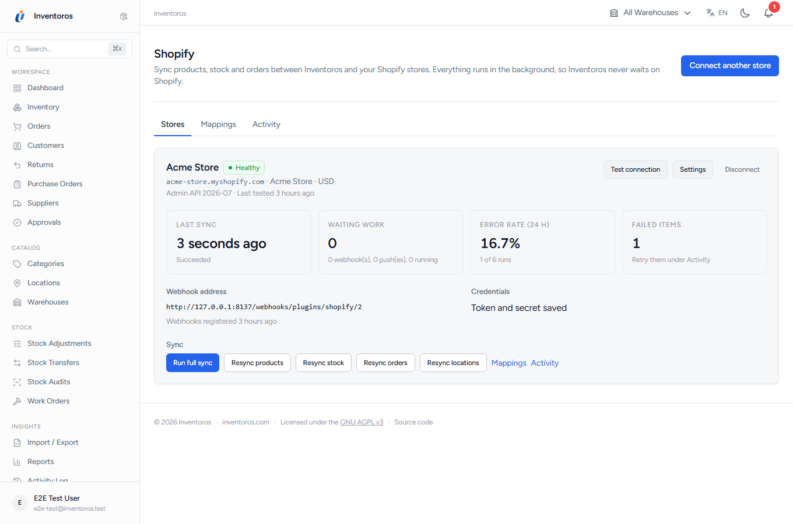
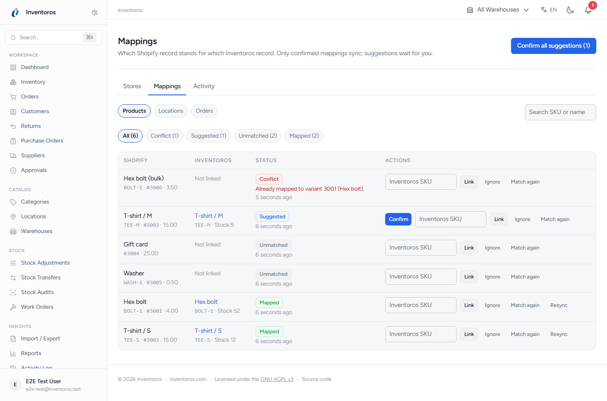
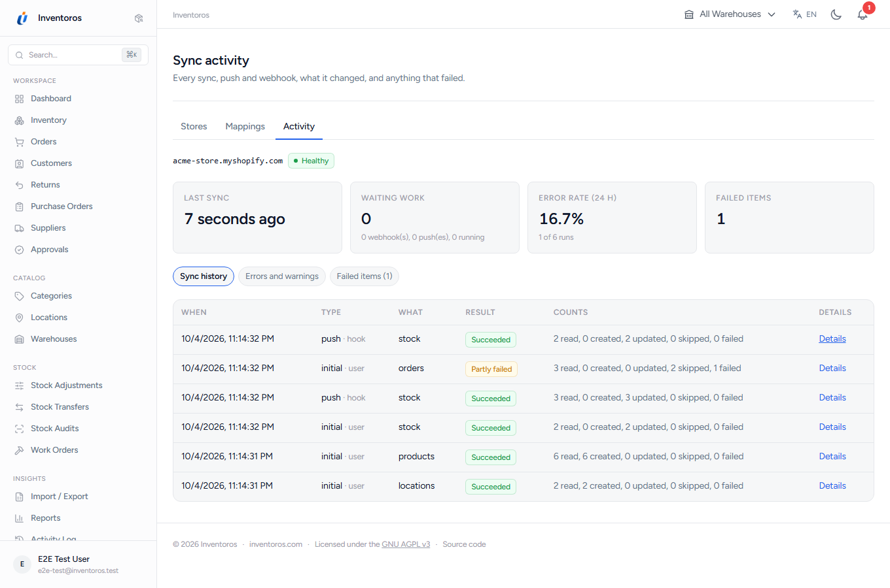

<p align="center">
  <a href="https://inventoros.com"></a>
</p>

<h1 align="center">Shopify for Inventoros</h1>

<p align="center">
  Two-way product, stock and order sync between Inventoros and Shopify.<br>
  A free, official Inventoros plugin that runs in the background so nothing waits on Shopify.
</p>

<p align="center">
  <a href="https://inventoros.com"><b>Website</b></a> ·
  <a href="https://inventoros.com/docs"><b>Docs</b></a> ·
  <a href="CHANGELOG.md"><b>Changelog</b></a>
</p>

<br>



## What it does

<table>
  <tr>
    <td width="40%">
      <h3>You confirm every match</h3>
      SKU matches stay suggestions until you confirm them, and conflicts and unmatched variants are listed instead of guessed.
    </td>
    <td width="60%">
      
    </td>
  </tr>
  <tr>
    <td width="60%">
      
    </td>
    <td width="40%">
      <h3>See what synced and what didn't</h3>
      Every run keeps its per-record log, and failed items wait in a list you can retry from.
    </td>
  </tr>
</table>

## Features

<table>
<tr>
<td width="33%" valign="top">

**Orders**
- Shopify orders imported exactly once
- Safe against replayed and out-of-order webhooks
- Cancellations cancel and restock through core

</td>
<td width="33%" valign="top">

**Stock and products**
- Stock sync either way, one owner
- Product sync either way, one owner
- Shopify locations mapped to warehouses

</td>
<td width="33%" valign="top">

**Mapping review**
- SKU matches suggested, you confirm
- Conflicts and unmatched variants listed

</td>
</tr>
<tr>
<td width="33%" valign="top">

**Webhooks and sync**
- HMAC-verified webhooks, idempotent inbox
- 15-minute incremental sync as a safety net
- No Inventoros request waits on Shopify

</td>
<td width="33%" valign="top">

**Retries and health**
- Retry-After, cost limits, backoff, circuit breaker
- Retry failed work from the UI
- Last sync, waiting work, error rate, run logs

</td>
<td width="33%" valign="top">

**Extending it**
- `order_imported` and `sync_failed` webhook events
- Read-only `shopify_sync_status` MCP tool
- Built on the shared integration kit

</td>
</tr>
</table>

<p align="center"><sub><a href="docs/features.md">Every feature in detail</a></sub></p>

<p align="center">
  <a href="https://inventoros.com"></a>
  <a href="https://www.php.net"></a>
  <a href="https://vuejs.org"></a>
  <a href="https://shopify.dev/docs/api/admin-graphql"></a>
</p>

## Quick start

Download `shopify-X.Y.Z.zip` from the [releases](https://github.com/Inventoros/plugin-shopify/releases), upload it in **Plugins** and activate it. From source:

```bash
cd ui && npm ci && npm run build && cd ..
cp -r . /path/to/inventoros/plugins/shopify     # the folder name is the slug
php artisan plugin:activate shopify              # from the Inventoros root
```

Then connect a store under **Shopify > Connect a store**. The queue worker and scheduler must be running; see [Install](docs/install.md).

## Learn more

- [All features and screenshots](docs/features.md) · [Install](docs/install.md) · [Set up a store, step by step](docs/setup.md)
- [How sync behaves](docs/sync.md) · [Sync options: backfills, payments, shipments, rate limits](docs/sync-options.md)
- [Configuration, permissions and compatibility](docs/configuration.md) · [FAQ](docs/faq.md)
- [Develop and test](docs/development.md) · [Integration kit](src/Kit/README.md) · [Contributing](CONTRIBUTING.md) · [Security](SECURITY.md)
- [Inventoros docs](https://inventoros.com/docs)

## License

AGPL-3.0-or-later. See [LICENSE](LICENSE).
