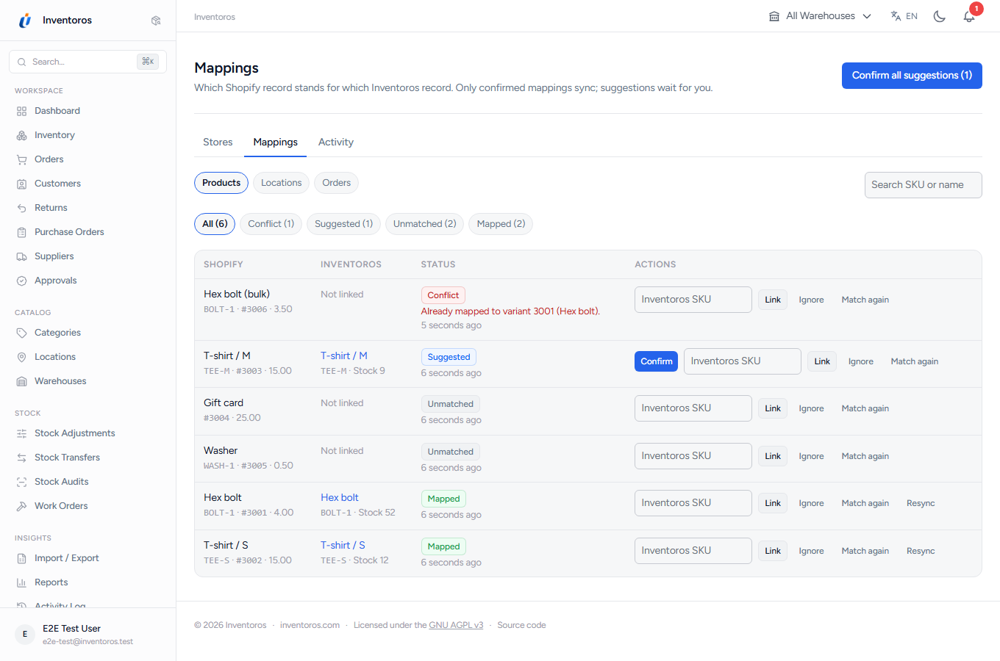
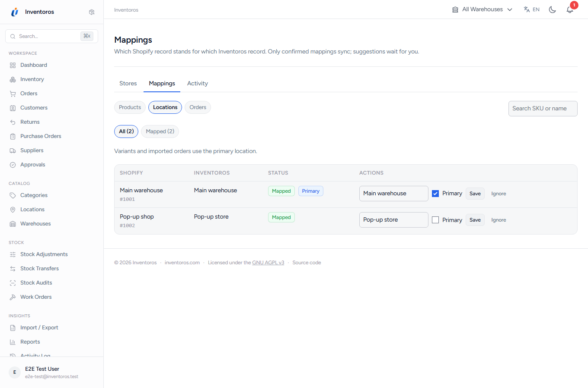
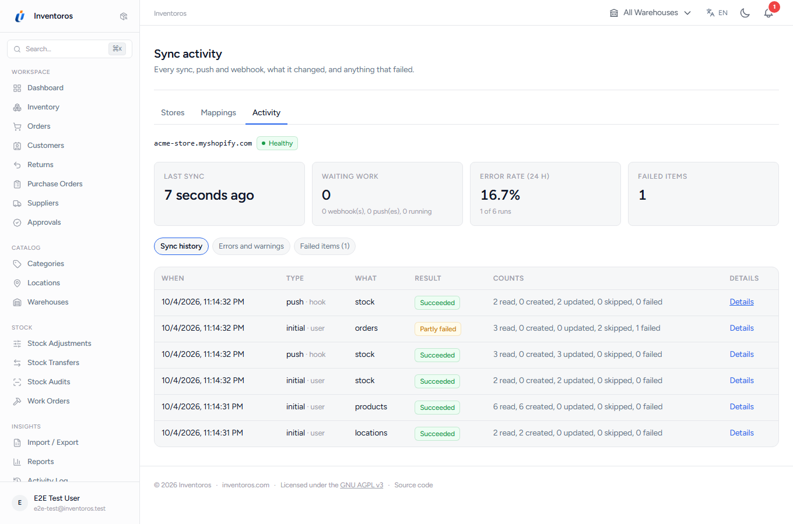
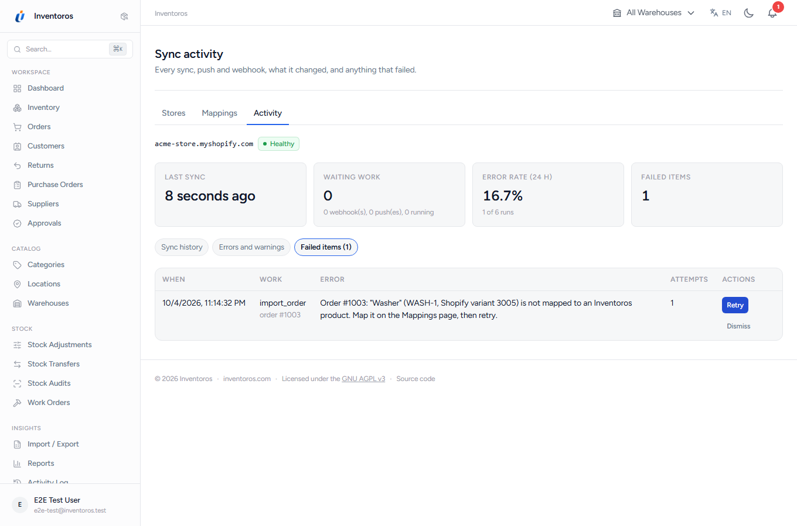
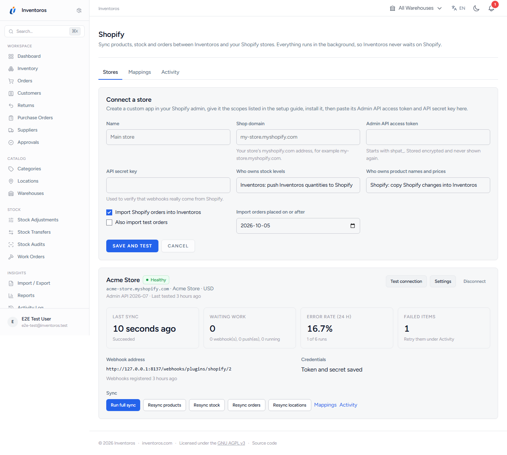
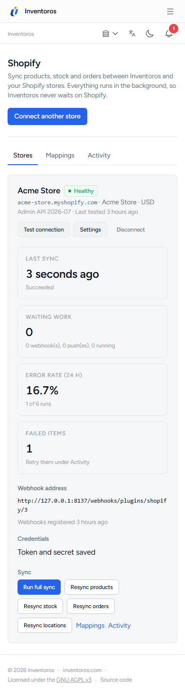

# Features

## Features

- **Orders into Inventoros, exactly once**: through core's `OrderService` (ledger rows, bins, serials), with `external_reference` set, safe against duplicate, replayed and out-of-order webhooks. Shopify cancellations cancel and restock through core.
- **Stock both ways, one owner**: Inventoros quantities pushed per mapped location, coalesced per item and queued; or Shopify levels applied as audited core adjustments.
- **Products both ways, one owner**: Shopify titles and prices copied into Inventoros, or Inventoros edits pushed to Shopify.
- **Mapping review**: SKU matches are suggestions until you confirm them; conflicts and unmatched variants are listed, never guessed. Shopify locations map to warehouses.
- **Webhooks** verified by HMAC, stored in an idempotent inbox and processed in the background, plus a 15-minute incremental sync as a safety net.
- **Retries and rate limits**: Retry-After, Shopify's GraphQL cost limit, backoff, a circuit breaker, and failed work you can retry from the UI.
- **Health and history**: last sync, waiting work, error rate, every run with its per-record log, errors and failed items.
- **Never blocks Inventoros**: no request waits on Shopify.
- `shopify.order_imported` and `shopify.sync_failed` webhook events, and a read-only `shopify_sync_status` MCP tool.
- Built on the reusable [integration kit](../src/Kit/README.md) shared by the Inventoros integration plugins.

## Screenshots

| | |
|-|-|
|  |  |
|  |  |
|  |  |
